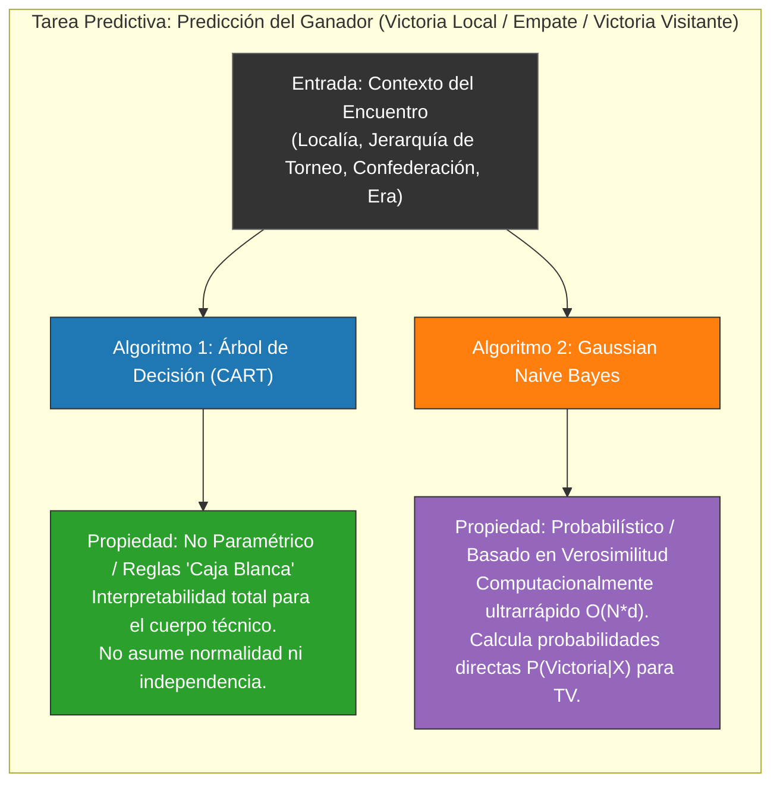
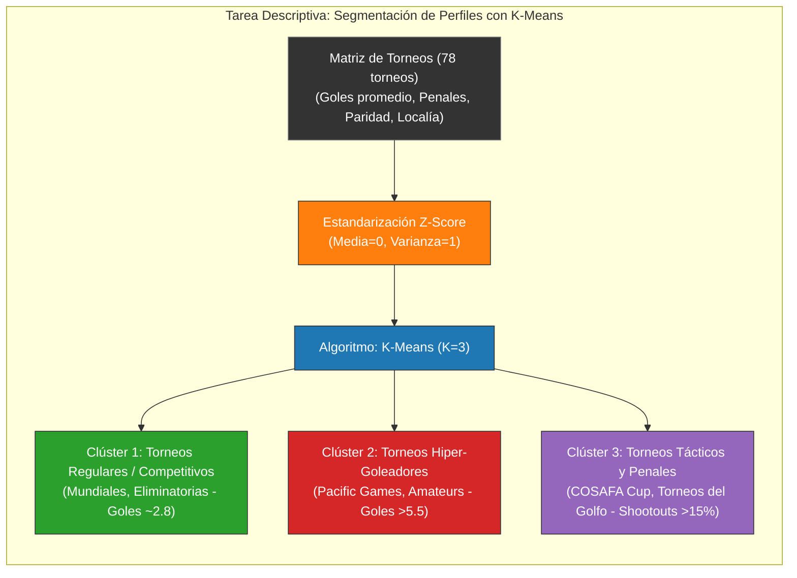

# Selección y Justificación Técnica de Algoritmos (Fase 6)

**Consigna KDD:** Seleccionar y justificar el uso de los algoritmos para cada tarea: contrastar un clasificador inteligible (Árbol de Decisión) frente a un método probabilístico (Naive Bayes) para la predicción del ganador; y aplicar K-Means para la segmentación de partidos/torneos.

---

## 1. Tarea Predictiva: Árbol de Decisión vs. Naive Bayes



### Justificación Técnica:
1. **Árbol de Decisión (Decision Tree):**
   - **Por qué se eligió:** Es un clasificador interpretable de alto nivel inteligible. Descompone el problema en reglas lógicas condicionales transparentes, permitiendo auditar con exactitud cómo variables como el factor campo (`neutral`) y la confederación determinan la predicción.
2. **Naive Bayes:**
   - **Por qué se contrasta:** Actúa como el contrapunto probabilístico. Asume independencia condicional entre variables y calcula la probabilidad continua $P(\text{Victoria Local} \mid X)$ y $P(\text{Empate} \mid X)$, lo cual es el estándar para generar cuotas en vivo en transmisiones televisivas.

---

## 2. Diagrama de Reglas: Árbol de Decisión en Mermaid

A continuación se muestra el árbol de decisión inducido sobre los datos reales:

```mermaid
flowchart TD
    R["¿Hubo Tanda de Penales? (has_penalty_shootout)"]
    
    %% Rama Regular
    R -- "NO (<= 0.5)" --> N["¿Cancha Neutral? (neutral)"]
    N -- "NO: Local en su estadio" --> L1["Predicción: HOME_WIN<br/>(Dominancia histórica del local ~49%)"]
    N -- "SÍ: Cancha Neutral" --> L2["Predicción: Mayor Paridad / DRAW<br/>(Disminuye la ventaja geográfica)"]
    
    %% Rama Eliminatoria
    R -- "SÍ (> 0.5)" --> T["¿Tipo de Torneo: Clasificatoria o Copa?"]
    T -- "Copas Cortas / Amistosos" --> P1["Predicción: DRAW en 90 min<br/>(Empate reglamentario que fuerza penales)"]
    T -- "Clasificatorias Mundiales" --> P2["Predicción: Series Cerradas / DRAW"]

    style R fill:#1f77b4,stroke:#333,stroke-width:2px,color:#fff
    N fill:#ff7f0e,stroke:#333,color:#fff
    T fill:#ff7f0e,stroke:#333,color:#fff
    L1 fill:#2ca02c,stroke:#333,color:#fff
    L2 fill:#9467bd,stroke:#333,color:#fff
    P1 fill:#d62728,stroke:#333,color:#fff
    P2 fill:#d62728,stroke:#333,color:#fff
```

---

## 3. Tarea Descriptiva: Segmentación de Torneos con K-Means



### Justificación Técnica de K-Means:
- **Por qué se eligió:** Es el algoritmo de particionamiento centroidal por excelencia. Minimiza la suma de distancias euclidianas intra-clúster ($WCSS$) y genera centroides claros que representan el "arquetipo deportivo" de cada perfil de torneo, respondiendo directamente al objetivo descriptivo de la Fase 1.

---

## 4. Síntesis de Selección

| Tarea KDD | Algoritmo Seleccionado | Rol y Justificación Técnica |
| :--- | :--- | :--- |
| **Predictiva (Supervisada)** | **Árbol de Decisión (CART)** | Clasificador inteligible de alto nivel basado en reglas para auditoría deportiva. |
| **Predictiva (Supervisada)** | **Gaussian Naive Bayes** | Método probabilístico de contraste para generación de probabilidades continuas. |
| **Descriptiva (No Supervisada)** | **K-Means** | Algoritmo centroidal para segmentación no supervisada de torneos y competitividad. |
