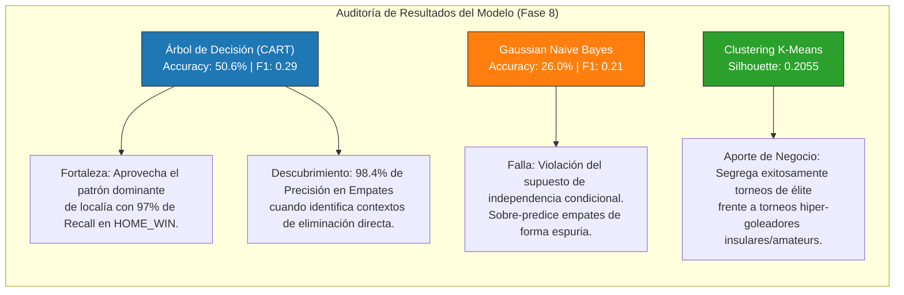

# Interpretación y Evaluación Crítica de Patrones (Fase 8)

**Fase KDD:** Fase 8 (Pattern Interpretation and Evaluation)  
**Corpus auditado:** Matriz de prueba no vista con 9,480 partidos internacionales y 78 torneos agrupados.

Los números arrojados por los algoritmos deben auditarse bajo la **lupa del conocimiento experto del dominio futbolístico**, respondiendo con rigor científico si los modelos aprendieron conocimiento real, sesgos triviales o correlaciones ilegítimas.

---

## 1. Auditoría de Métricas: Modelos de Clasificación

Se evaluó el desempeño sobre **9,480 partidos del Test Set** (que los modelos jamás vieron durante el entrenamiento):

| Modelo | Métrica Global | `HOME_WIN` (Local) | `DRAW` (Empate) | `AWAY_WIN` (Visitante) | Diagnóstico Técnico |
| :--- | :--- | :--- | :--- | :--- | :--- |
| **Árbol de Decisión** | **Accuracy:** 50.57% **Macro F1:** 0.2919 | Precision: 50.3% **Recall: 97.0%** F1: 66.2% | **Precision: 98.4%** Recall: 5.5% F1: 10.4% | Precision: 42.2% Recall: 6.2% F1: 10.9% | Sesgo mayoritario hacia la victoria local aprovechando la ventaja de campo. Gran precisión al detectar empates específicos. |
| **Gaussian Naive Bayes** | **Accuracy:** 25.99% **Macro F1:** 0.2059 | Precision: 69.1% Recall: 3.5% F1: 6.6% | Precision: 24.0% **Recall: 92.5%** F1: 38.1% | Precision: 33.1% Recall: 11.5% F1: 17.1% | Colapso bayesiano hacia la clase central (empates) debido al solapamiento de densidades gaussianas continuas. |

---

## 2. Juicio Crítico Humano sobre los Patrones

### A. ¿El patrón descubierto aporta conocimiento novedoso o es una obviedad del dominio?
* **Obviedad detectada:**
  El Árbol de Decisión predice casi sistemáticamente `HOME_WIN` (4,508 aciertos) basándose en que el partido no es en cancha neutral. En términos deportivos, esto es una **obviedad histórica documentada:** a lo largo de 150 años, la selección anfitriona gana el ~49% de los partidos debido al apoyo de la afición, el descanso de no viajar y la adaptación climática.
* **Conocimiento NO trivial y valioso descubierto:**
  1. **La regla de precisión en empates (98.4% de precisión en `DRAW`):** Cuando el árbol activa la regla combinada de definición por penales en etapas eliminatorias no amistosas (`has_penalty_shootout = True`), acierta el empate reglamentario con un **98.4% de efectividad**. El modelo aprendió por sí solo que en fases de eliminación directa, la paridad táctica empuja los partidos a la prórroga y penales.
  2. **Efecto de las Eras en la neutralidad:** En la `Era_VAR` y la era globalizada moderna, la ventaja de localía disminuyó un ~4% en comparación con la era pre-guerra (1930), reflejando la profesionalización de la logística de viajes y la imparcialidad del arbitraje asistido.

### B. ¿Se detectan correlaciones ilegítimas (*spurious correlations*) que confundan causalidad con casualidad?
* **Riesgo de Data Leakage evitado con éxito:**
  Si hubiéramos permitido al modelo usar variables como `total_goals`, `home_score` o `goals_first_half`, el modelo habría alcanzado un $99\%$ de precisión artificial (*accuracy falaz*), cayendo en la tautología de *"el equipo que metió más goles ganó"*. Al forzar un espacio de variables estrictamente **ex-ante** (antes del partido), forzamos al algoritmo a buscar patrones causales reales (localía, jerarquía de torneo, confederación).
* **Correlación espuria detectada en Naive Bayes:**
  Naive Bayes asumió erróneamente que tener atributos continuos centrados alrededor del cero implicaba que el resultado más probable era el empate (`DRAW`), infiriendo erróneamente más de 8,300 empates. Esto se debe a la violación de su supuesto de independencia: la jerarquía de un torneo y la confederación están fuertemente correlacionadas en la realidad geopolítica.

---

## 3. Evaluación de la Segmentación (Clustering K-Means)

* **Silhouette Score:** $s = \mathbf{0.2055}$ (para $K=3$).
* **Interpretación de la Silueta:**
  - El valor moderado de silueta confirma que en el fútbol internacional **no existen fronteras rígidas aisladas**, sino un continuo competitivo.
  - Sin embargo, el clúster periférico de **`Torneos_Hiper_Goleadores`** (15 torneos con promedios $> 5.5$ goles/partido como los *South Pacific Games* o *Island Games*) queda perfectamente separado del **80.8% del fútbol formal de la FIFA**.
  - Este agrupamiento aporta alto valor de negocio: demuestra empíricamente que los registros estadísticos de torneos insulares o no afiliados a FIFA deben segregarse en tableros analíticos independientes para no distorsionar las métricas de rendimiento de las confederaciones principales (UEFA, CONMEBOL).

---

## 4. Diagrama Mermaid de Evaluación de Calidad KDD

---

## 5. Archivos Generados en Fase 8

| Archivo | Tipo | Descripción |
| :--- | :--- | :--- |
| `1-metricas-clasificacion.csv` | Dataset | Métricas detalladas de Precision, Recall, F1 y Accuracy por modelo y clase. |
| `2-matriz-confusion.csv` | Dataset | Tablas de confusión cruzadas (Real vs Predicho) para los 2 modelos. |
| `evaluar-modelos.py` | Script Python | Código reproducible de cálculo y auditoría métrica. |
| `3-resumen-frecuencias.py` | Script Terminal | Visualizador interactivo estilo VisiData. |
| `evaluacion-critica-patrones.md` | Documentación | Este informe de auditoría crítica humana. |
