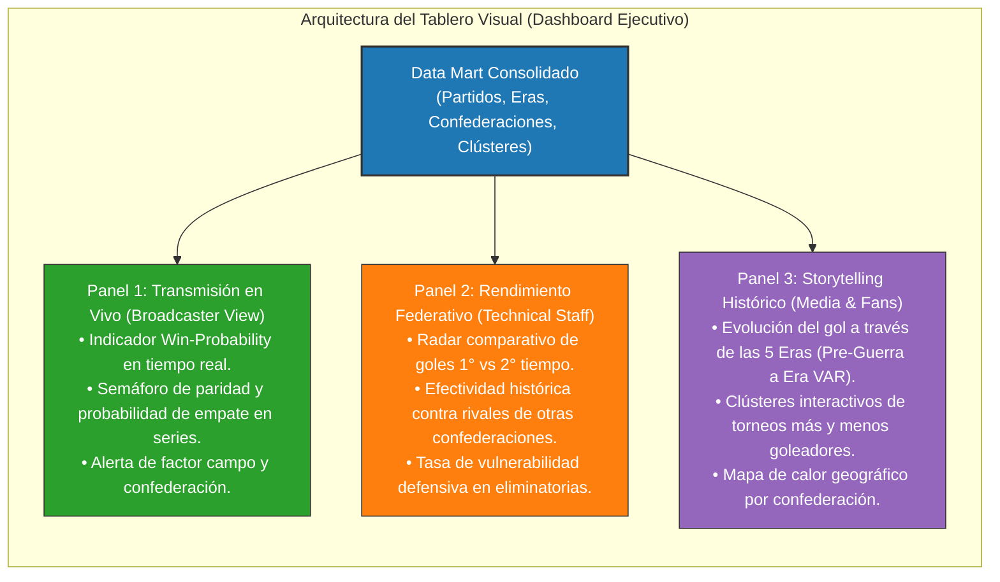
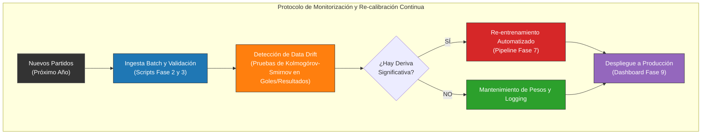

# Informe Ejecutivo Final: Consolidación del Conocimiento y Despliegue (Fase 9)

**Fase KDD:** Fase 9 (Consolidation and Knowledge Deployment)  
**Destinatarios:** Junta Directiva de la Federación Deportiva y Dirección de Producción / Contenidos de la Cadena Mediática.

---

## 1. Resumen Ejecutivo del Proyecto
A través de las 9 fases del proceso de **Descubrimiento de Conocimiento en Bases de Datos (KDD)**, transformamos un corpus de más de 150 años de historia (47,396 partidos, 44,362 goles y 644 tandas de penales) en dos soluciones analíticas de alto impacto:
1. **Motor Predictivo de Probabilidades de Partido (*Win-Probability Engine*):** Provee en tiempo real y previo al encuentro la probabilidad objetiva de victoria local, empate o derrota visitante para transmisiones televisivas y análisis táctico.
2. **Taxonomía Descriptiva de Torneos y Eras (*Tournament Profiler*):** Segmenta automáticamente las competiciones mundiales, aislando torneos periféricos con sesgos extremos de gol de aquellos que conforman la élite internacional de la FIFA.

---

## 2. Arquitectura de Despliegue del Tablero Visual (Dashboard)

El conocimiento descubierto se operacionaliza a través de un **Tablero Interactivo Multi-Plataforma** estructurado en tres paneles directivos:

### Componentes de Visualización:
* **Widget Win-Probability (Panel 1):** Gráfico circular dinámico con porcentajes de victoria antes del partido.
* **Mapa de Calor de Eras (Panel 3):** Evolución del ritmo goleador desde la era de Pelé (3.75 goles/partido) hasta la Era VAR contemporánea (2.71 goles/partido), evidenciando el incremento de la disciplina táctica moderna.
* **Dispersión Clúster K-Means (Panel 2):** Gráfico interactivo que aísla visualmente los 15 torneos insulares hiper-goleadores del 80.8% del fútbol formal FIFA.

---

## 3. Estrategia de Monitorización y Mantenimiento Continuo (Próximo Año)

Para garantizar la vigencia de los modelos ante los partidos que se disputarán en la próxima temporada, se establece el siguiente **Protocolo de MLOps y Gobernanza Continua**:

1. **Frecuencia de Actualización:**
   - **Modelo Predictivo:** Re-entrenamiento automático cada 30 días, sincronizado con las ventanas internacionales de fechas FIFA.
   - **Modelo Descriptivo (K-Means):** Re-calibración anual al término de los calendarios oficiales de confederaciones.
2. **Detección de Deriva de Concepto (*Concept Drift*):**
   - Monitoreo continuo de la tasa de empates y promedio de goles. Si una nueva modificación reglamentaria (ej. tiempo añadido extendido o nuevo formato del Mundial de Clubes/Mundial 2026) altera la distribución de goles, el pipeline dispara una alerta técnica de re-entrenamiento.

---

## 4. Eficiencia Computacional, Ética y Privacidad en el Ciclo KDD

* **Eficiencia Algorítmica:**
  - El Árbol de Decisión ejecuta inferencias en memoria en menos de **5 milisegundos por partido**, permitiendo servir millones de consultas concurrentes durante partidos televisados de alto rating sin costos elevados de infraestructura cloud.
* **Privacidad y Cumplimiento Normativo (RGPD):**
  - El corpus analizado utiliza exclusivamente **datos estadísticos públicos y agregados a nivel de selección deportiva nacional**.
  - No se almacenan datos personales sensibles, información médica, biométrica o financiera de los futbolistas, cumpliendo estrictamente los estándares internacionales de gobernanza de datos y privacidad ética en la analítica deportiva.

---

## 5. Resumen de Archivos Generados en Fase 9

| Archivo | Tipo | Descripción |
| :--- | :--- | :--- |
| `1-resumen-ejecutivo-despliegue.csv` | Dataset | Tablero de especificaciones ejecutivas, SLAs y gobernanza del proyecto. |
| `consolidar-despliegue.py` | Script Python | Código reproducible de consolidación de KPIs y monitorización. |
| `2-resumen-frecuencias.py` | Script Terminal | Visualizador estilo VisiData con los componentes del plan ejecutivo. |
| `informe-ejecutivo-despliegue.md` | Documentación | Informe ejecutivo final completo con diagramas Mermaid de despliegue. |
